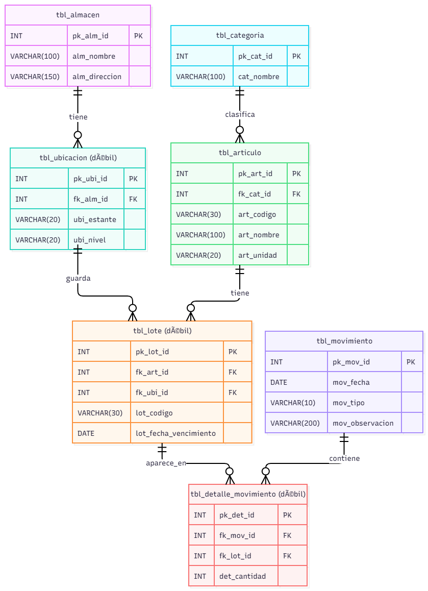

<p align="center">
  
</p>

# Sistema de Inventario Multialmacén

Proyecto Django del Grupo 1 (Programación Avanzada, Uniguajira). Sistema para controlar los productos que ingresan y salen de las bodegas de una empresa con varios almacenes. Registra artículos, lotes, la ubicación de cada lote (almacén y estante) y cada movimiento de entrada o salida. Toda la información se gestiona desde el panel de administración de Django.

## Integrantes

- Temistocle Eisyanior Atencio Ipuana
- Alain Manuel Suarez Vanegas
- Andrés Felipe Ballesteros De Luquez

## Tecnologías

- Python 3.14
- Django 6.1.2
- SQLite (db.sqlite3 incluida en el repositorio)
- Git y GitHub

## Actores y casos de uso

| Actor | Casos de uso |
|---|---|
| Administrador | Gestionar usuarios, Gestionar almacenes, Consultar reporte de movimientos |
| Jefe de bodega | Gestionar artículos, Gestionar lotes, Consultar stock por almacén |
| Bodeguero | Registrar entrada, Registrar salida, Consultar ubicación de lote |

## Estructura del proyecto

Cada tabla del diagrama ER es un modelo en su propia app:

| App | Modelo | Descripción |
|---|---|---|
| almacenes | Almacen | Bodegas de la empresa |
| ubicaciones | Ubicacion | Estantes de cada almacén (entidad débil) |
| categorias | Categoria | Categorías de artículos |
| articulos | Articulo | Productos del inventario |
| lotes | Lote | Lotes de cada artículo (entidad débil) |
| movimientos | Movimiento | Entradas y salidas |
| detalles_movimiento | DetalleMovimiento | Tabla intermedia del N:M entre Movimiento y Lote (cantidad) |

```
sistema-inventario/
├── config/                  # Configuración del proyecto (settings, urls)
├── almacenes/               # App + modelo Almacen
├── ubicaciones/             # App + modelo Ubicacion
├── categorias/              # App + modelo Categoria
├── articulos/               # App + modelo Articulo
├── lotes/                   # App + modelo Lote
├── movimientos/             # App + modelo Movimiento
├── detalles_movimiento/     # App + modelo DetalleMovimiento
├── docs/                    # Diagramas (casos de uso y ER) y logo
├── db.sqlite3               # Base de datos con datos de prueba
├── manage.py
├── requirements.txt
└── README.md
```

## Relaciones entre tablas

- Un **almacén** tiene muchas **ubicaciones**.
- Una **ubicación** guarda muchos **lotes**.
- Una **categoría** clasifica muchos **artículos**.
- Un **artículo** tiene muchos **lotes**.
- Un **movimiento** contiene muchos **detalles**, y cada detalle apunta a un **lote**. Así se resuelve la relación muchos a muchos entre Movimiento y Lote.

El stock no es una columna: se calcula sumando las entradas y restando las salidas registradas en DetalleMovimiento.

## Panel de administración

- Las 7 tablas están registradas en el admin, con listado, búsqueda y filtros.
- Las entidades débiles y la tabla intermedia se editan en línea (inlines):
  - Las ubicaciones se agregan dentro de cada almacén.
  - Los lotes se agregan dentro de cada artículo.
  - Los detalles (lote y cantidad) se agregan dentro de cada movimiento.
- Cada lote muestra su **stock actual** y cada artículo su **stock total**, calculados con las entradas y salidas de DetalleMovimiento.
- No se permite registrar una **salida mayor al stock disponible** del lote: el admin muestra un error de "Stock insuficiente".
- La base de datos ya incluye 3 registros de prueba por tabla.

## Requisitos previos

- Python 3.14 (o una versión compatible con Django 6.1)
- Git

## Cómo ejecutarlo

1. Clonar el repositorio y entrar a la carpeta:

```
git clone https://github.com/temispremium-cloud/sistema-inventario.git
cd sistema-inventario
```

2. Crear y activar el entorno virtual (Windows PowerShell):

```
py -m venv venv
venv\Scripts\Activate.ps1
```

3. Instalar dependencias:

```
python -m pip install -r requirements.txt
```

4. Aplicar migraciones (la base db.sqlite3 ya incluye datos de prueba):

```
python manage.py migrate
```

5. Iniciar el servidor:

```
python manage.py runserver
```

6. Abrir http://127.0.0.1:8000/admin/

## Credenciales del administrador

- Usuario: admin
- Contraseña: Inventario2026

## Diagramas

### Casos de uso
Tres actores (Administrador, Jefe de bodega y Bodeguero) y las nueve funciones que usa cada uno.


### Modelo entidad-relación
Siete tablas. Ubicación y Lote son entidades débiles, y la relación muchos a muchos entre Movimiento y Lote se resuelve con la tabla intermedia DetalleMovimiento.

